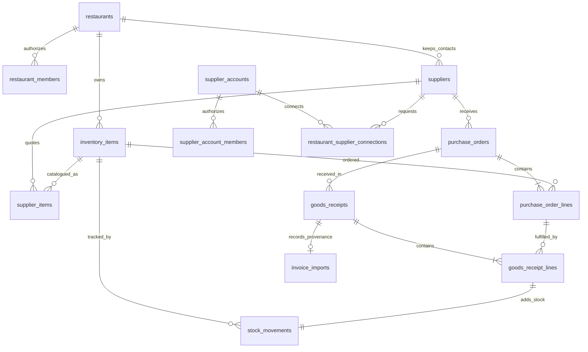

# Database structure and setup

This repository contains the SQL source for the existing Supabase-backed Inventory application. It is not a database backup and contains no real restaurant records or application accounts.

## Main relationships

The diagram describes application workflows. Exact constraints and column definitions are in the migrations.

| Tables / view | Purpose |
| --- | --- |
| `restaurants`, `restaurant_members` | Restaurant workspace and user roles linked to Supabase `auth.users` |
| `inventory_items` | Ingredient master, restaurant-scoped SKU, fixed base unit, category and reorder point |
| `suppliers`, `supplier_items` | Restaurant-specific contacts and supplier catalog packaging/quotes |
| `purchase_orders`, `purchase_order_lines` | Ordered items and historical quantities/prices |
| `goods_receipts`, `goods_receipt_lines` | Actual partial or complete deliveries |
| `stock_movements` | Signed inventory ledger: opening, receipt, usage, waste and adjustment |
| `inventory_levels` (view) | Current balances and low-stock flags calculated from the ledger |
| `supplier_accounts`, `supplier_account_members` | Independent supplier businesses and their authorized users |
| `restaurant_supplier_connections` | Requested, accepted or revoked links between supplier businesses and restaurant supplier contacts |
| `invoice_imports` | Confirmed invoice metadata, file fingerprint and receipt linkage; not the original PDF |

Quantities are in each ingredient's base unit. A catalog pack quote is converted to a per-base-unit suggestion when ordering. Stock charts separate incompatible units; supplier value charts separate currencies.

## Business writes and access

- `create_restaurant` creates a restaurant and its owner membership.
- `create_purchase_order`, `receive_purchase_order`, `record_stock_movement` and `cancel_purchase_order` validate the caller and business rules before committing changes.
- `receive_invoice` checks invoice provenance and duplicates, then uses the receiving workflow to update stock, receipts and order progress atomically.
- `create_supplier_account` creates a supplier workspace. Restaurant requests and supplier responses use `request_supplier_connection` and `respond_supplier_connection`.
- Supplier reads use the permitted portal functions and projections. Accepted connections expose only the supplier's own orders and deliveries, not restaurant stock, usage, waste, other suppliers or private invoice metadata.

Row-level security and function authorization enforce membership. A UI portal selection or knowledge of a connection code alone does not grant access. Retry IDs are used by the supported workflows to avoid duplicate submissions after uncertain network responses; restaurant creation itself does not yet have an idempotency key.

## Set up a separate Supabase backend

For source review or the sample workspace, no database setup is required. The supplied browser configuration connects to the existing application. For an independent environment:

1. Create a separate Supabase project and keep database/admin credentials outside this repository.
2. Review and apply the five SQL migration files below in chronological order using the project's SQL Editor as an administrator. They are not safe to rerun indiscriminately on an existing application schema.
3. Configure email/password Auth, confirmation requirements, your own Site URL, and permitted local/hosted redirect URLs.
4. Edit `dist/config.js`: set `SUPABASE_URL`, the browser-public `SUPABASE_PUBLISHABLE_KEY`, and `SITE_URL` for your deployment. Never use a service-role or secret key in this browser file. For local callback testing, use `http://127.0.0.1:4173` and allow that address in your independent project's Auth settings.
5. Start the website, create and confirm an application account, sign in and create a restaurant. For the supplier workflow, create a supplier workspace, request a connection from the restaurant and accept it from the supplier portal.

| Apply order | File |
| --- | --- |
| 1 | `202610290001_inventory_schema.sql` |
| 2 | `202610290002_inventory_workflows.sql` |
| 3 | `202610290003_indexes_and_trigger_privileges.sql` |
| 4 | `202611090001_supplier_portal.sql` |
| 5 | `202611160001_invoice_receiving.sql` |

The original project's migrations were applied using SQL Editor, not recorded in Supabase CLI migration history. Do not run a blind `db push` against that existing database. The third migration conditionally restricts a Supabase-created automatic-RLS function if present; it does not install that platform function.

`seed_demo.sql` is optional fictional teaching data. It does not grant a signed-in user membership in its demonstration restaurant. The browser's sample workspace is separate and needs no SQL seed. Prefer creating an empty test restaurant through the website for interactive write testing.

## Validation

The normal frontend checks are `npm run check` and `npm test`. SQL suites under `supabase/tests/` require administrator access and should be reviewed and run against an isolated test project. Their temporary data is rolled back. The `*_dry_run.sql` files include the relevant migration for pre-application testing; they are not additional migrations to apply after the schema exists. `automatic_rls.sql` only applies to projects where the Supabase automatic-RLS trigger is installed.

Prior validation reported 17 original inventory checks, 15 supplier-access checks and 19 invoice checks. These historical results do not replace verification in a newly created environment. See [validation history](VALIDATION-HISTORY.md) for scope and limitations. This GitHub handoff does not apply migrations or change live database access.
